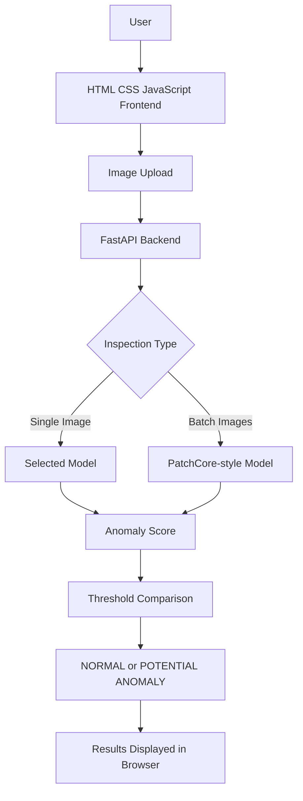
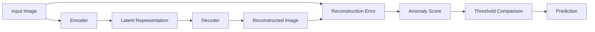
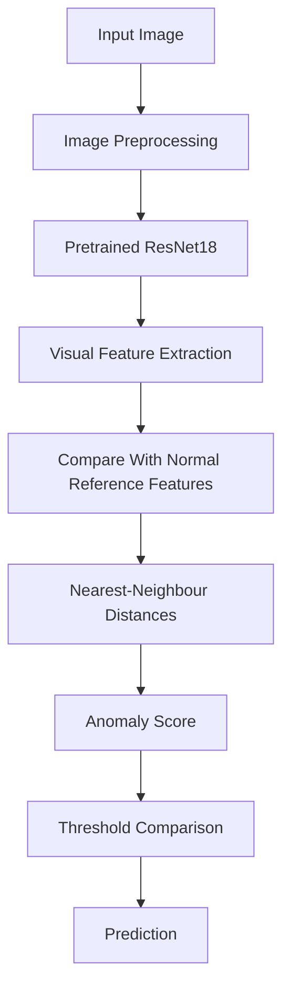

# Industrial-Anomaly-Detection
**AI-Powered Visual Anomaly Detection for Industrial Quality Inspection**

Industrial AI Inspector is a web-based AI prototype designed to detect potentially defective metal nuts from images. It combines a web interface, a Python backend, and two deep-learning approaches: a **CNN Autoencoder** and a **PatchCore-style anomaly detection model**.

The project demonstrates how computer vision can support industrial quality control by identifying unusual visual patterns in product images.

> **Project Status:** Working local prototype with single-image and batch inference connected to saved models. Some dashboard analytics remain illustrative/demo data. The project has not yet been validated for production industrial use.

---

## 📌 Table of Contents

- [Overview](#-overview)
- [Problem Statement](#-problem-statement)
- [Objectives](#-objectives)
- [Key Features](#-key-features)
- [System Architecture](#-system-architecture)
- [How It Works](#-how-it-works)
- [AI Models](#-ai-models)
- [Technology Stack](#-technology-stack)
- [Dataset](#-dataset)
- [Project Structure](#-project-structure)
- [Installation](#-installation)
- [Running the Application](#-running-the-application)
- [Using the Application](#-using-the-application)
- [API Documentation](#-api-documentation)
- [Understanding Predictions](#-understanding-predictions)
- [Sample Results](#-sample-results)
- [Evaluation and Limitations](#-evaluation-and-limitations)
- [Troubleshooting](#-troubleshooting)
- [Future Improvements](#-future-improvements)
- [Acknowledgements](#-acknowledgements)
- [License](#-license)

---

## 🔍 Overview

Industrial quality inspection involves examining manufactured products to identify defects such as scratches, deformations, and unusual surface appearances.

Manual inspection can be repetitive and may produce inconsistent results. Computer vision offers a way to analyze product images using a consistent, model-based scoring process.

Industrial AI Inspector focuses on the **`metal_nut` category of the MVTec Anomaly Detection (MVTec AD) dataset**.

Users can upload images through a browser, select an available model for single-image inspection, and view prediction results. The application also supports batch inspection through the PatchCore-style model.

### Main Goals

- Demonstrate AI-based industrial visual inspection.
- Detect potentially anomalous product images.
- Compare two anomaly-detection approaches.
- Provide an interactive web interface.
- Support single-image and batch inference.
- Expose model functionality through a Python API.
- Make model predictions accessible without requiring users to run inference scripts manually.

## 🎯 Problem Statement

Traditional industrial inspection often depends on manual visual checking. This process can be time-consuming, repetitive, and difficult to scale consistently.

The goal of this project is to build a prototype that analyzes metal-nut images and identifies samples that may contain visual anomalies.

The system uses trained models to calculate anomaly scores and compares those scores with configured thresholds to produce a prediction.

**Important:** This project is an experimental decision-support prototype. It currently analyzes uploaded images and does not control physical cameras, conveyor belts, or automatic product-rejection mechanisms.

---

## 🎯 Objectives

1. Build a browser-based interface for industrial image inspection.
2. Integrate trained deep-learning models with a Python backend.
3. Implement single-image inference.
4. Implement batch-image inference.
5. Display model predictions and anomaly scores.
6. Provide API endpoints for inference and model-status checks.
7. Explore the strengths and limitations of reconstruction-based and feature-comparison-based anomaly detection.
8. Establish a foundation for future industrial inspection improvements.

---

## ✨ Key Features

### 1. Interactive Web Dashboard

A web interface built using HTML, CSS, and JavaScript provides access to the inspection functionality.

It includes interface elements for navigating the application, selecting images, viewing results, and interacting with the available features.

Some overview-dashboard metrics and monitoring-style information remain demo data.

### 2. Single-Image Inspection

Users can upload one image and select one of the available models:

- CNN Autoencoder
- PatchCore-style

The backend processes the image and returns the prediction information for display in the interface.

### 3. Multiple AI Models

The application includes two different approaches to anomaly detection.

The CNN Autoencoder uses reconstruction error, while the PatchCore-style model compares visual features against reference features learned from normal samples.

### 4. Batch Inspection

Users can select multiple images and process them through a single request.

The interface displays the results returned for each image.

The current batch-inspection interface uses the PatchCore-style model directly.

### 5. Anomaly Scores and Thresholds

The application uses a model-specific anomaly score and threshold to determine whether an image should be classified as normal or flagged as a potential anomaly.

An anomaly score is not automatically a probability that a product is defective.

### 6. Model Status

The backend provides an endpoint that reports whether the saved model files are ready for inference.

### 7. Prediction History

The backend exposes an endpoint for retrieving available prediction history.

Whether the history persists across server restarts depends on the implemented storage mechanism.

### 8. API Documentation

FastAPI automatically provides interactive API documentation, allowing developers to inspect and test endpoints.

### 9. Input Feedback and Error Messages

The interface provides feedback during batch processing and displays messages when an upload or inference request fails.

### 10. Dashboard Analytics

The dashboard contains monitoring-style elements intended to demonstrate an industrial inspection interface.

**Some analytics and simulated camera information are illustrative data, not measurements from a live factory or a complete model-evaluation report.**

---

## 🏗️ System Architecture

The application contains three main layers:

1. **Frontend:** Displays the interface and handles user interactions.
2. **Backend:** Receives requests, invokes the selected model, and returns results.
3. **AI inference layer:** Loads saved models and calculates anomaly predictions.

### Architecture Diagram



### Request Flow

1. The user selects an image in the browser.
2. JavaScript prepares a multipart form-data request.
3. The browser sends the request to the backend.
4. FastAPI receives the image and selected model information.
5. The backend invokes the appropriate model implementation.
6. The model calculates an anomaly score and prediction.
7. The backend returns the result.
8. JavaScript updates the interface.

---

## ⚙️ How It Works

### Step 1: Image Upload

The user selects an image of a metal nut through the web interface.

The frontend checks the selected file and prepares it for submission.

### Step 2: Backend Request

JavaScript sends the image to the FastAPI backend using an HTTP request.

The image is transmitted as multipart form data.

### Step 3: Image Processing

The backend prepares the image according to the requirements of the selected model.

The exact preprocessing operations depend on the model implementation.

### Step 4: Model Inference

The selected model analyzes the image and calculates its anomaly score.

- The CNN Autoencoder uses reconstruction-based information.
- The PatchCore-style model uses feature comparisons against normal reference features.

### Step 5: Threshold Comparison

The anomaly score is compared with the model's configured threshold.

- A score on the normal side of the threshold produces `NORMAL`.
- A score above the threshold produces `POTENTIAL ANOMALY`.

### Step 6: Display Results

The backend returns the result to the browser.

The frontend displays the available prediction information, including the score and other returned fields.

---

## 🧠 AI Models

### 1. CNN Autoencoder

#### What Is an Autoencoder?

An autoencoder is a neural network that learns to encode an input into a representation and reconstruct the original input from that representation.

In anomaly detection, the reconstruction difference can be used to estimate how unusual an image is.

#### Architecture



#### Components

**Encoder:** Converts the input image into a compact feature representation.

**Latent representation:** Contains learned information about the image.

**Decoder:** Attempts to reconstruct the original image.

**Reconstruction error:** Measures the difference between the original and reconstructed image.

**Anomaly threshold:** Converts the anomaly score into a prediction.

#### Why Use a CNN Autoencoder?

A convolutional autoencoder can learn visual patterns such as textures, edges, and shapes. It provides a reconstruction-based approach to identifying unusual images.

#### Advantages

- Learns visual features automatically.
- Provides a straightforward reconstruction-based anomaly score.
- Can be used as a baseline for anomaly detection.
- Does not require a separate output class for every possible defect type.

#### Limitations

- Some defects may be reconstructed well.
- Normal variations can produce high reconstruction errors.
- Results depend on training, preprocessing, and threshold selection.
- A normal prediction does not guarantee that the physical product is defect-free.

### 2. PatchCore-Style Model

#### What Is PatchCore-Style Anomaly Detection?

The PatchCore-style implementation compares visual features from an input image with reference features derived from normal images.

The implementation uses pretrained **ResNet18 features** and nearest-neighbour comparisons.

It is described as *PatchCore-style* rather than an exact reproduction of the original PatchCore research method.

#### What Is ResNet18?

ResNet18 is a convolutional neural network with residual connections.

Its pretrained layers can extract useful visual patterns such as edges, textures, shapes, and higher-level image features.

Using a pretrained model to reuse learned features is an example of **transfer learning**.

#### Workflow



#### Main Components

**Feature extraction:** Converts image regions into numerical representations.

**Normal reference features:** Represent visual patterns learned from normal training images.

**Nearest-neighbour comparison:** Compares features from the input image with similar reference features.

**Anomaly score:** Summarizes how unusual the image appears according to the implementation.

**Anomaly map:** Where generated and displayed, it indicates image regions that the model considers unusual.

#### Advantages

- Reuses pretrained visual features.
- Compares local visual patterns.
- Can help identify unusual surface details.
- Can provide spatial anomaly information where supported.

#### Limitations

- Harmless visual variations may be flagged.
- Some defects may not be detected.
- Results depend on feature extraction, reference features, preprocessing, and thresholds.
- An anomaly score does not automatically identify the exact defect category.

### Model Comparison

| Aspect | CNN Autoencoder | PatchCore-Style |
|---|---|---|
| Main approach | Image reconstruction | Feature comparison |
| Main anomaly signal | Reconstruction error | Feature-distance-based score |
| Reference | Learned reconstruction behaviour | Normal reference feature bank |
| Feature extraction | Autoencoder network | Pretrained ResNet18 |
| Primary use | Reconstruction-based baseline | Local visual anomaly detection |
| Main limitation | May reconstruct some defects well | May flag harmless variations |

Scores from the two models should not be directly compared as calibrated probabilities because their scoring methods and scales differ.

---

## 🛠️ Technology Stack

| Technology | Purpose |
|---|---|
| Python | Backend logic and model inference |
| FastAPI | API endpoints and request handling |
| Uvicorn | Runs the FastAPI application |
| PyTorch | Loads and executes the saved deep-learning models |
| ResNet18 | Pretrained feature extraction for the PatchCore-style model |
| HTML | Frontend structure |
| CSS | Frontend styling and layout |
| JavaScript | File uploads, API requests, and dynamic result updates |
| MVTec AD | Industrial anomaly-detection dataset |

### Why These Technologies?

**Python:** Provides the ecosystem needed for machine learning, image processing, and backend development.

**FastAPI:** Provides a clean way to expose Python functionality through HTTP endpoints.

**Uvicorn:** Runs the FastAPI application locally.

**PyTorch:** Supports loading and running the saved model checkpoints.

**HTML, CSS, and JavaScript:** Provide the user interface without requiring the frontend to run the Python model directly.

**ResNet18:** Provides pretrained image features for the PatchCore-style approach.

The exact package versions should be taken from the repository's `requirements.txt`.

---

## 📂 Dataset

This project uses the **`metal_nut` category of the MVTec Anomaly Detection (MVTec AD) dataset**.

The dataset includes normal metal-nut images and multiple defect categories.

### Expected Directory Structure

```text
data/
└── metal_nut/
    ├── train/
    │   └── good/
    │
    ├── test/
    │   ├── good/
    │   ├── bent/
    │   ├── color/
    │   ├── flip/
    │   └── scratch/
    │
    └── ground_truth/
        ├── bent/
        ├── color/
        ├── flip/
        └── scratch/
```

### Folder Explanation

| Folder | Purpose |
|---|---|
| `train/good/` | Normal training images |
| `test/good/` | Normal test images |
| `test/bent/` | Images containing bent nuts |
| `test/color/` | Images with color or appearance anomalies |
| `test/flip/` | Images with unusual orientation |
| `test/scratch/` | Images containing scratches |
| `ground_truth/` | Reference defect masks where provided |

Ground-truth masks can be used to evaluate whether a model correctly identifies the location of defects.

Having these masks in the dataset does not by itself mean that pixel-level localization metrics have already been calculated.

### Dataset Usage Note

Review the official dataset terms and citation requirements before redistributing it. Do not commit the full dataset to a public repository unless the applicable terms permit it.

If the dataset is not included in the repository, document how users can obtain it and place it in the expected directory.

---

## 📁 Project Structure

```text
industrial-ai-inspector/
│
├── frontend/
│   └── index.html
│
├── src/
│   ├── autoencoder.py
│   ├── patchcore_model.py
│   └── common.py
│
├── data/
│   └── metal_nut/
│       ├── train/
│       ├── test/
│       └── ground_truth/
│
├── models/
│   ├── autoencoder.pt
│   └── patchcore.pt
│
├── reports/
│
├── server.py
├── app.py
├── requirements.txt
└── README.md
```

This is a high-level view of the project. The exact contents may differ slightly depending on the files included in your repository.

### File and Folder Explanation

| File or Folder | Purpose |
|---|---|
| `frontend/index.html` | Main HTML/CSS/JavaScript interface |
| `src/autoencoder.py` | Autoencoder-related model implementation |
| `src/patchcore_model.py` | PatchCore-style model implementation |
| `src/common.py` | Shared utilities |
| `data/metal_nut/` | Local dataset |
| `models/autoencoder.pt` | Saved autoencoder checkpoint |
| `models/patchcore.pt` | Saved PatchCore-style checkpoint |
| `reports/` | Location for reports or generated outputs, if present |
| `server.py` | FastAPI application and API routes |
| `app.py` | Additional application file; inspect its code to confirm its role |
| `requirements.txt` | Python dependency list |
| `README.md` | Project documentation |

**Note:** Do not commit virtual environments, temporary files, backups, or large datasets unnecessarily.

---

## 💻 Installation

### Prerequisites

- Python compatible with the project's dependencies.
- pip.
- Git, if cloning from GitHub.
- The required model checkpoint files.
- The dataset if required by the code path you intend to run.

The commands below use macOS/Linux shell syntax unless stated otherwise.

### Step 1: Clone the Repository

After publishing the repository to GitHub:

```bash
git clone <YOUR_GITHUB_REPOSITORY_URL>
cd <YOUR_PROJECT_FOLDER>
```

Replace the placeholders with your actual repository URL and folder name.

If you already have the project locally, open its root folder instead.

### Step 2: Create a Virtual Environment

```bash
python3 -m venv .venv
source .venv/bin/activate
```

A virtual environment keeps the project's Python packages separate from those of other projects.

**Windows PowerShell:**

```powershell
python -m venv .venv
.\.venv\Scripts\Activate.ps1
```

### Step 3: Install Dependencies

```bash
python -m pip install --upgrade pip
pip install -r requirements.txt
```

If you are using an existing environment, activate that environment instead.

Make sure the installed libraries are compatible with the model code and saved checkpoints.

### Step 4: Verify Required Files

Check that the project contains:

```text
server.py
requirements.txt
frontend/index.html
models/autoencoder.pt
models/patchcore.pt
```

If the model files or dataset are not included in the repository, follow the project's documented instructions for obtaining them.

---

## ▶️ Running the Application

### Step 1: Activate the Environment

If you created a new environment:

```bash
source .venv/bin/activate
```

### Step 2: Start FastAPI

Run this command from the project root:

```bash
python -m uvicorn server:app --reload
```

The terminal should indicate that the server is running.

Keep the terminal open while using the application.

### Step 3: Open the Application

- **Main application:** http://127.0.0.1:8000
- **Interactive API documentation:** http://127.0.0.1:8000/docs
- **Model status:** http://127.0.0.1:8000/api/status

### Step 4: Stop the Server

Press `Ctrl+C` in the terminal running Uvicorn.

### Development Environment Note

During development, the project was run on macOS using an existing virtual environment located outside the integrated project folder:

```bash
source ~/Downloads/industrial-ai-inspector/.venv/bin/activate
cd ~/Downloads/industrial-ai-inspector-exact-frontend
python -m uvicorn server:app --reload
```

This path is specific to the original development computer. Other users should activate their own compatible environment.

---

## 🖥️ Using the Application

### Single-Image Inspection

1. Start the backend.
2. Open the application in your browser.
3. Navigate to the single-image inspection feature.
4. Upload a supported image.
5. Select `CNN Autoencoder` or `PatchCore-style`.
6. Run the inspection.
7. Review the prediction and returned score information.

### Batch Inspection

1. Open the batch-inspection feature.
2. Select multiple supported images.
3. Start batch processing.
4. Wait for the backend to finish inference.
5. Review the results for each image.

**Selecting multiple files:**

- macOS: Hold `Command (⌘)` while clicking individual files.
- Windows/Linux: Hold `Ctrl` while clicking individual files. `Shift` can select a range.

The current frontend limits batch selection to 30 images and uses the PatchCore-style model for batch inference.

### Understanding the Output

- `NORMAL`: The score is on the normal side of the model's threshold.
- `POTENTIAL ANOMALY`: The score exceeds the model's threshold.
- The anomaly score measures unusualness according to the selected model.
- A score is not automatically a calibrated probability of a defect.

---

## 🔌 API Documentation

The FastAPI backend exposes the following endpoints.

| Method | Endpoint | Purpose |
|---|---|---|
| `GET` | `/` | Serves the main frontend |
| `GET` | `/api/status` | Reports model readiness |
| `POST` | `/api/predict` | Processes one image |
| `POST` | `/api/batch` | Processes multiple images |
| `GET` | `/api/history` | Returns available prediction history |
| `GET` | `/docs` | Interactive API documentation |

### 1. `GET /api/status`

Checks whether the saved models are available to the backend.

A ready status means the backend reports the model as loaded and available. It does not indicate accuracy.

### 2. `POST /api/predict`

Performs single-image inference.

Expected multipart form fields:

- `file`: the image to inspect.
- `model`: `CNN Autoencoder` or `PatchCore-style`.

Use the interactive documentation at `/docs` to inspect the current response schema.

### 3. `POST /api/batch`

Performs inference on multiple images.

Expected multipart form field:

- `files`: one or more image files.

The current frontend submits the PatchCore-style model for batch processing.

### 4. `GET /api/history`

Retrieves prediction history available through the current backend implementation.

Whether history persists after restarting the server depends on how the backend stores it.

### 5. `GET /docs`

Provides an interactive interface for exploring and testing the API.

---

## 📊 Understanding Predictions

A threshold-based decision can be represented as:

\[
\hat{y} =
\begin{cases}
\text{NORMAL}, & s \leq t\\
\text{POTENTIAL ANOMALY}, & s > t
\end{cases}
\]

Where:

- \(s\) is the anomaly score.
- \(t\) is the configured decision threshold.
- \(\hat{y}\) is the displayed prediction.

The score calculation differs between the two models.

A lower threshold generally increases sensitivity to unusual images but may also increase false alarms. A higher threshold may reduce false alarms while allowing more defects to go undetected.

Thresholds should be selected using appropriate validation data for the intended application.

---

## 🧪 Sample Results

The following are selected predictions observed during integration testing.

| Model | Sample Category | Score | Threshold | Prediction |
|---|---|---:|---:|---|
| CNN Autoencoder | Good | 0.20821 | 0.23216 | NORMAL |
| CNN Autoencoder | Bent | 0.20269 | 0.23216 | NORMAL |
| PatchCore-style | Good | 0.68449 | 0.75251 | NORMAL |
| PatchCore-style | Bent | 0.86142 | 0.75251 | POTENTIAL ANOMALY |
| PatchCore-style | Color | 0.75923 | 0.75251 | POTENTIAL ANOMALY |
| PatchCore-style | Flip | 0.85043 | 0.75251 | POTENTIAL ANOMALY |
| PatchCore-style | Scratch | 0.67775 | 0.75251 | NORMAL |

These results are example observations, **not a complete benchmark or a measure of overall accuracy**.

The autoencoder classified the tested bent sample as normal, while the PatchCore-style model classified the tested scratch sample as normal. These examples show that the system can miss defects and needs broader evaluation.

---

## ⚠️ Evaluation and Limitations

### What Has Been Verified

- The FastAPI application starts locally.
- The status endpoint reported both saved models as ready.
- Single-image inference was tested.
- Batch inference was tested.
- Example model results were displayed in the frontend.

### Current Limitations

- The current test results cover selected examples rather than the complete held-out test set.
- Some defects are missed by the models.
- Some overview-dashboard analytics and simulated monitoring values remain demo data.
- Batch inference currently uses the PatchCore-style model.
- The application processes uploaded images rather than live camera feeds.
- The project does not control physical inspection equipment.
- Model thresholds and score calibration require systematic evaluation.
- Production security, scalability, monitoring, and deployment require further work.

### Recommended Evaluation

To measure model performance more reliably, evaluate both models on an appropriate held-out test set and report:

- Precision
- Recall
- F1-score
- False-positive and false-negative counts
- ROC-AUC or precision-recall analysis where appropriate
- Per-defect-category results
- Pixel-level localization metrics if anomaly maps are available
- Inference latency under consistent conditions

Keep training, threshold-selection, and final test data separate to reduce the risk of overly optimistic results.

---

## 🛠️ Troubleshooting

### Error: `uvicorn: command not found`

Run:

```bash
python -m uvicorn server:app --reload
```

If Uvicorn is not installed, activate the correct environment and install the requirements.

### Error: `ModuleNotFoundError`

Activate the correct virtual environment and run:

```bash
python -m pip install -r requirements.txt
```

### Model Is Not Ready

1. Check that the model checkpoint exists in `models/`.
2. Start the server from the project root.
3. Check the terminal for model-loading errors.
4. Confirm the package versions and checkpoint format are compatible.

### Website Does Not Open

1. Check that Uvicorn is still running.
2. Open `http://127.0.0.1:8000`.
3. Check the terminal for startup errors.
4. Do not use VS Code Live Server for this setup; FastAPI serves the frontend.

### Image Upload or Inference Fails

1. Try a supported image format.
2. Confirm that the image is not corrupted.
3. Read the error message shown in the interface.
4. Check the Uvicorn terminal for backend errors.
5. Test the endpoint through `http://127.0.0.1:8000/docs`.

### Dataset Not Found

Check that the dataset folder matches the paths expected by the model code. Saved-model inference may not require the full training dataset for every request, while training or evaluation code may require it.

---

## 🚀 Future Improvements

Possible improvements include:

- Evaluate both models on the complete held-out dataset.
- Improve anomaly thresholds and score calibration.
- Reduce missed defects and false alarms.
- Add per-defect-category evaluation.
- Validate anomaly maps against ground-truth masks.
- Integrate a live industrial camera.
- Replace illustrative dashboard metrics with real inference statistics.
- Add persistent database-backed history.
- Allow users to choose the model for batch inference.
- Improve backend file validation and authentication.
- Add automated tests and continuous integration.
- Package the application with Docker.
- Add model versioning and monitoring.
- Deploy the system in a controlled environment after validation.

---

## 🙌 Acknowledgements

- **MVTec AD:** Industrial anomaly-detection dataset and `metal_nut` category.
- **PyTorch:** Deep-learning model execution.
- **FastAPI:** Backend API framework.
- **Uvicorn:** Local ASGI server.
- **ResNet18:** Pretrained feature extraction for the PatchCore-style model.

Please consult the official documentation for the dataset, libraries, pretrained weights, and their respective citation and licensing requirements.

---

## 📄 License

No project license has been specified in this README.

Before publishing the repository publicly, add a `LICENSE` file that reflects how you want others to use your code. Also check the terms for the dataset, pretrained weights, and saved model checkpoints.

Do not assume that a license you select for your own code automatically covers third-party datasets or model weights.

---

**Industrial AI Inspector — Visual anomaly detection to support smarter quality inspection.**
